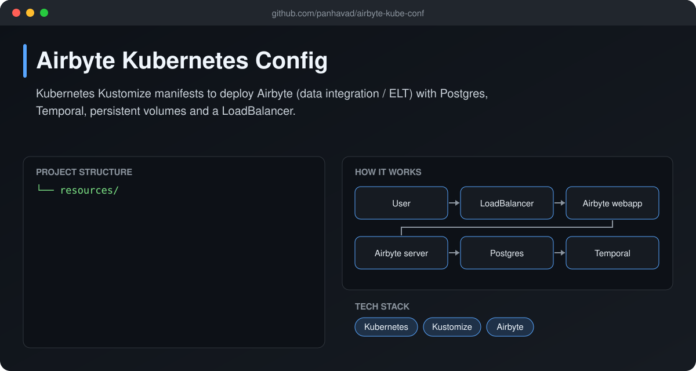
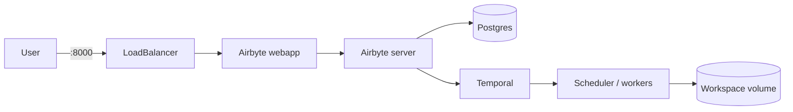

# Airbyte Kubernetes Config

 [](https://github.com/panhavad/airbyte-kube-conf/releases/latest)

**Kustomize manifests to run [Airbyte](https://airbyte.com) on Kubernetes** - the open-source ELT / data-integration platform - including database, Temporal, scheduler, server, web app, persistent volumes and a LoadBalancer service.



## Features

- Single `kubectl apply -k` deploy
- Postgres DB, Temporal, scheduler, server and webapp
- Persistent volumes for configs, DB and workspace
- LoadBalancer on ports 8000 (web) / 8001 (API)

## How it works



## Getting started

```bash
kubectl apply -k resources/
kubectl get svc airbyte-webapp-loadbalancer
```

## Download

Grab the packaged source from the [latest release](https://github.com/panhavad/airbyte-kube-conf/releases/latest).

## Tech stack

- Kubernetes
- Kustomize
- Airbyte

## Project structure

```text
airbyte-kube-conf/
├── docs/
├── resources/
└── README.md
```
